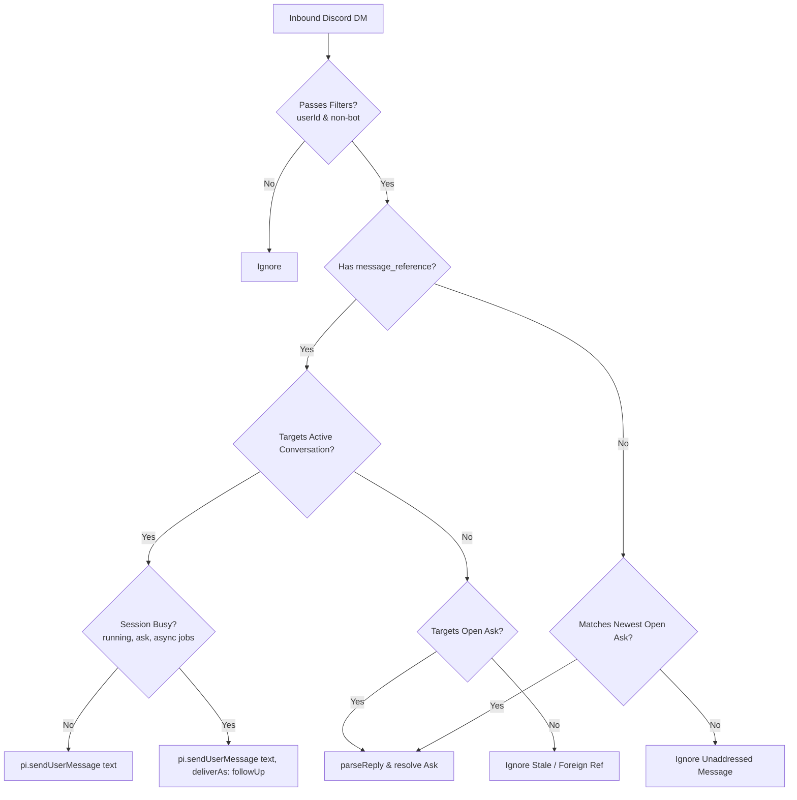

# Active Session Prompting via Discord Relay

**Date:** 2026-10-29  
**Status:** Implemented locally; pending PR

---

## 1. Executive Summary

Expanding `omp-lemmeaskchat` from an ask-answer relay to an active session prompter is now implemented and shipped via the Away Mode conversation controller (`src/away-session.ts`, `src/discord/bridge.ts`, `src/config.ts`, `src/index.ts`). The host package `@oh-my-pi/pi-coding-agent` (confirmed on minimum peer `18.12.4` and installed `18.13.3`) provides an in-process action method `pi.sendUserMessage(content, options)` on the root `ExtensionAPI`.

When called on an idle session, it injects a real user turn into the conversation, updates the terminal transcript, preserves the user's in-progress terminal editor draft, and starts an LLM turn. When called on a busy session, options allow queuing behind the active run (`deliverAs: "followUp"`), steering mid-run (`deliverAs: "steer"`), or injecting at a step boundary (`deliverAs: "aside"`).

The production implementation operates safely through the following mechanisms:
1. **Bridge Lifetime (Away-Owned Connection):** The Discord Gateway connection is owned by Away Mode (`/lemmeaskchat away on`/`off`) and active `ask` tool calls, rather than holding an always-on connection across the entire session. Turning away mode on connects to the Gateway immediately; turning away mode off or idle timeout expiry (default: 900s, configurable: 1..2147483s) releases the conversation reference (stopping the Gateway if no active ask remains). Outside away mode, the Gateway is acquired on-demand only during active `ask` tool calls. Disabling away mode or timing out stops the remote relay only and never aborts an active model generation.
2. **Instance Addressing via Quote-Replies:** To support multiple `omp` sessions sharing a single bot token without a cross-process coordinator, prompts are addressed by quote-replying to any of that session's bot conversation messages (initial status notices or turn completion announcements). All message chunks (up to 2,000 characters) are registered in `ActiveDiscordConversation`. Unaddressed, foreign, or stale replies are rejected and never injected.
3. **Prompt vs. Answer Disambiguation:** Inbound messages with a `message_reference` check active conversation targets first (routing to `onPrompt()`), then check open asks (routing to `parseReply()`). Unquoted messages NEVER start new prompts; when an open ask is pending, an unquoted message may resolve that ask via `parseReply()`, otherwise it is ignored.

---

## 2. Primary Source Evidence & Upstream Host APIs

### 2.1 Package & Repository Identity
- **Package:** `@oh-my-pi/pi-coding-agent`
- **Official Monorepo:** [`can1357/oh-my-pi`](https://github.com/can1357/oh-my-pi/tree/master/packages/coding-agent) (directory `packages/coding-agent`)
- **Homepage:** [omp.sh](https://omp.sh)
- **Version Tarballs:**
  - Minimum peer: [`@oh-my-pi/pi-coding-agent@18.12.4.tgz`](https://registry.npmjs.org/@oh-my-pi/pi-coding-agent/-/pi-coding-agent-18.12.4.tgz)
  - Installed workstation runtime: [`@oh-my-pi/pi-coding-agent@18.13.3.tgz`](https://registry.npmjs.org/@oh-my-pi/pi-coding-agent/-/pi-coding-agent-18.13.3.tgz) (`/home/carter/.local/bin/omp`)

### 2.2 Exact API Signatures
Defined in [`packages/coding-agent/src/extensibility/extensions/types.ts:1946-1949`](https://cdn.jsdelivr.net/npm/@oh-my-pi/pi-coding-agent@18.13.3/src/extensibility/extensions/types.ts) and implemented in [`packages/coding-agent/src/session/agent-session.ts:10230-10284`](https://cdn.jsdelivr.net/npm/@oh-my-pi/pi-coding-agent@18.13.3/src/session/agent-session.ts):

```typescript
export interface SendUserMessageOptions {
  /** Queue behavior; omitted starts a turn when idle and steers while streaming. */
  deliverAs?: "steer" | "followUp" | "aside";
  /** Explicit attribution: "user" | "agent" | "system". */
  attribution?: "user" | "agent" | "system";
}

export interface ExtensionAPI {
  sendUserMessage(
    content: string | (TextContent | ImageContent)[],
    options?: SendUserMessageOptions,
  ): void;
}
```

For the Discord relay, passing plain string `content: string` is standard.

### 2.3 Injection Semantics
- **Real User Turn:** Unlike `sendMessage` (which posts custom extension cards and metadata entries), `sendUserMessage` injects a standard, non-synthetic `role: "user"` prompt turn into the agent prompt pipeline ([`agent-session.ts:10230-10284`](https://cdn.jsdelivr.net/npm/@oh-my-pi/pi-coding-agent@18.13.3/src/session/agent-session.ts)). It triggers LLM generation and commits to session history.
- **Commands & Templates:** Sets `expandPromptTemplates: false` internally. Slash commands (`/compact`, `/help`) and `$template` variable expansions are not evaluated; input is delivered directly as prompt text.
- **TUI & Draft Preservation:** In [`packages/coding-agent/src/modes/controllers/event-controller.ts:1230-1253`](https://cdn.jsdelivr.net/npm/@oh-my-pi/pi-coding-agent@18.13.3/src/modes/controllers/event-controller.ts), inbound user messages append to the chat view and call `ui.requestRender(true)`. The code explicitly avoids clearing the prompt editor so that an external injection does not erase an operator's in-progress terminal draft.
- **Availability:** In [`packages/coding-agent/src/extensibility/extensions/loader.ts:117-119`](https://cdn.jsdelivr.net/npm/@oh-my-pi/pi-coding-agent@18.13.3/src/extensibility/extensions/loader.ts), calling action methods during module initialization throws `ExtensionRuntimeNotInitializedError`. Action methods are wired during session runner initialization ([`runner.ts:810-815`](https://cdn.jsdelivr.net/npm/@oh-my-pi/pi-coding-agent@18.13.3/src/extensibility/extensions/runner.ts)) before `session_start` fires. Storing the `pi` reference received in `export default function(pi)` makes `pi.sendUserMessage()` safely callable in event listeners, timers, or background network callbacks.

### 2.4 Idle vs. Busy vs. Steer Behaviors
Implemented across [`agent-session.ts:9374-9537`](https://cdn.jsdelivr.net/npm/@oh-my-pi/pi-coding-agent@18.13.3/src/session/agent-session.ts) and [`@oh-my-pi/pi-agent-core/src/agent.ts:1392-1423`](https://cdn.jsdelivr.net/npm/@oh-my-pi/pi-agent-core@18.13.3/src/agent.ts):

- **Idle Session:**
  - Omitted `deliverAs` or `deliverAs: "aside"`: Starts a new turn immediately.
  - `deliverAs: "followUp"` / `"steer"`: Queues message without immediately starting a turn.
- **Busy Session (Streaming / Executing):**
  - Omitted `deliverAs`: Defaults to `"steer"`.
  - `deliverAs: "followUp"`: Pushes to `#followUpQueue`. Waits until the entire agent run settles (all turns and tool batches complete), then starts a new turn.
  - `deliverAs: "steer"`: Pushes to `#steeringQueue`. Runs after the currently executing tool finishes, aborts remaining queued tool calls in the batch, and starts the next LLM call with the steer prompt.
  - `deliverAs: "aside"`: Pushes to `#irc.queueAside()`. Injects at the next step boundary without aborting remaining tools in the active batch.
- **Active Tool Interruption Boundaries:** Upstream documentation and code note that steering immediately interrupts special interruptible waits (`wait` / sleep / timer), but it does not generically force-abort arbitrary active tool executions (e.g. an in-progress subprocess or network request); the active tool execution must complete before steering delivers.

### 2.5 Session Identity
Accessible via `ctx.sessionManager` ([`packages/coding-agent/src/session/session-manager.ts:726-751`](https://cdn.jsdelivr.net/npm/@oh-my-pi/pi-coding-agent@18.13.3/src/session/session-manager.ts)):
- `ctx.sessionManager.getSessionId()`: Returns the unique session UUID string.
- `ctx.sessionManager.getSessionFile()`: File path to the active session `.jsonl`.
- `ctx.agent.kind`: `"main"` vs `"sub"`. Extensions must verify `ctx.agent.kind === "main"` to avoid spawning redundant bridges in subagents.

---

## 3. Observed Runtime Verification

### 3.1 Verification Setup
An isolated smoke test was executed against `/home/carter/.local/bin/omp` (v18.13.3) under the following parameters:
- `PI_CODING_AGENT_DIR=/tmp/lemmeaskchat-smoke-agent-dir`
- Flags: `--mode rpc --no-ui --no-extensions -e <smoke-extension> --no-session --no-tools --no-skills --no-rules --no-context-files --no-title --model session-smoke/local --cwd /tmp`
- **Network / Auth Isolation:** No external provider API calls and no real credentials. The extension registered an in-process OpenAI-compatible mock endpoint on loopback HTTP (`127.0.0.1`) using `Bun.serve` with a dummy key.
- **Persistence:** `--no-session` ran with ephemeral in-memory history, verifying in-memory multi-turn progression without writing to disk.

### 3.2 Verification Results
1. **Idle Injection:** In `session_start`, calling `pi.sendUserMessage('SMOKE_IDLE_PROMPT')` triggered `agent_start` and dispatched a request to the loopback HTTP server. (Note: The host automatically prepends a date/cwd system reminder to the first user turn content received by the model).
2. **Busy Queuing:** While the first mock response was in flight, calling `pi.sendUserMessage('SMOKE_BUSY_FOLLOWUP', { deliverAs: 'followUp' })` emitted a `queue_update` follow-up event. When the first turn settled, the second turn ran automatically, producing consecutive assistant replies `LOCAL_ACK_1` and `LOCAL_ACK_2`.
3. **Outcome:** `SESSION_SMOKE_RESULT pass:true, requests:2`.

### 3.3 Interactive Host Smoke Proof (omp 18.13.3 PTY)
An interactive PTY smoke test was executed against `omp 18.13.3` with the real plugin implementation wired into the real bridge singleton:
- **Environment & Configuration:**
  - `PI_CODING_AGENT_DIR=/tmp/lemmeaskchat-away-host-smoke-agent-dir`
  - Command: `omp --no-extensions -e /tmp/lemmeaskchat-away-host-smoke.ts --no-skills --no-rules --no-context-files --no-session --no-title --no-tools --model away-smoke/local --cwd /tmp`
  - FakeDiscord was injected into the SAME real bridge singleton (`src/discord/bridge.ts`).
  - Loopback `Bun.serve` OpenAI SSE provider running locally with a dummy key (no real Discord network connection and no external LLM provider calls).
- **Execution Scenario:**
  - Real `session_start` sets session title to `Away smoke session`.
  - Initial `pi.sendUserMessage` dispatched to start the conversation.
  - Each local generation delayed by 1500ms and 1100ms (configured > 1s away idle timeout to verify runner behavior under delayed responses).
- **Observed Flow & Output:**
  - Named completion 1 delivered to FakeDiscord: `Session “Away smoke session” has finished — awaiting response.`
  - Exact quote-reply followed up AFTER completion 1, dispatching turn 2 (both generations exceeded 1s timeout; verified timeout did not fire while generation was active, but did not test busy-input injection mid-turn).
  - Second turn ran with preserved conversational model history.
  - Named completion 2 delivered to FakeDiscord.
  - After generation settled, 1-second idle timeout expired: `away` set to `false` and fake gateway stopped cleanly.
  - Verification payload emitted:
    ```text
    AWAY_HOST_SMOKE_RESULT pass:true requests2 completions2 firstCompletionValidated:true secondCompletionValidated:true modelHistoryPreserved:true fakeConnectedDuringRequests:true timeoutExpiredAwayFalse:true fakeGatewayStopped:true
    ```
  - Both user and model turns, along with the custom session title, rendered in the interactive TUI.

### 3.4 Scope & Limitations
- **Verified in Interactive Smoke:** Real in-process `pi.sendUserMessage` calls, preserved multi-turn history, session-named completion messages, quote-reply prompting after completion, both generations exceeding the configured idle timeout without premature expiry, and idle expiry afterward resetting `away: false` and releasing the Gateway. Ask-answer precedence, chunked replies, reconnect deduplication, and busy-input injection are covered separately by behavioral tests, not this interactive smoke.
- **Not Verified in Smoke Tests:** Inbound prompt injection while a model generation or tool execution is actively running (busy follow-up queueing), live Discord network Gateway/REST endpoints, and production LLM providers.
---

## 4. Local Relay Mechanics (`omp-lemmeaskchat`)

### 4.1 Discord Gateway Intent & Content Capabilities
- `src/discord/gateway.ts:469-482` connects with `intents: 4096` (`DIRECT_MESSAGES`, $1 \ll 12$).
- Under [Discord Gateway Intent Specifications](https://docs.discord.com/developers/events/gateway#gateway-intents), Direct Messages with the bot are explicitly exempt from the privileged `MESSAGE_CONTENT (1 << 15)` intent requirement. Full text is received on `MESSAGE_CREATE` (`src/discord/gateway.ts:396-399`).

### 4.2 Resolution of Previous Unsolicited DM Limitations
The prior limitations identified in research have been resolved in the built implementation:
1. **Bridge Disconnects on Idle:**
   - Resolved by `AwaySessionController`: enabling away mode calls `bridge.openConversation()`, which acquires the bridge and connects the Gateway immediately. The Gateway remains connected until away mode is explicitly disabled or the idle timeout expires (`awayTimeoutSeconds`, default 900s, configurable 1..2147483s), which releases the conversation reference (stopping the Gateway if no active ask remains). Disconnecting the Gateway stops the remote bridge only; it never aborts active model execution.
2. **Dropping Messages with Zero Open Asks:**
   - Resolved by `ActiveDiscordConversation`: messages with `message_reference` targeting a registered conversation message ID route directly to `onPrompt()`, even when `open.size === 0`.
3. **Ambiguity with Ask Answers:**
   - Resolved by target-based routing: quote-replies to conversation messages route exclusively to `onPrompt()`. Quote-replies or button interactions on open questions route to `parseReply()`. Unquoted messages never start new prompts; if an open ask is pending, an unquoted message may resolve the ask via `parseReply()`, otherwise it is safely dropped.

### 4.3 Multi-Session Hazards with Shared Bot Token
- Direct Messages are non-guild events and always route to shard 0 ([Discord Sharding Docs](https://docs.discord.com/developers/events/gateway#sharding)). Discord sends `MESSAGE_CREATE` to every active Gateway connection using that bot token.
- Each `omp` process runs an independent bridge instance with separate state in module-local variables (`src/discord/bridge.ts:664-690`). Processes have no shared coordinator.
- Working directories and session names are not guaranteed unique (e.g. multiple sessions in the same repo or unrenamed sessions).
- **Hazard:** Without per-instance addressing, an unsolicited prompt received on Discord would be dispatched into every running `omp` session simultaneously.

### 4.4 Reconnect Catch-up Hazard
- `src/discord/bridge.ts:403-434` (`catchUpAfterReconnect`) fetches up to 50 recent DM messages on reconnection and replays them through `handleMessage`.
- Without a high-water mark (`lastSeenMessageId`) and timestamp check, historical prompts could be re-injected upon reconnecting.

---

## 5. Built Architecture & Integration Seams



### 5.1 Host Types Seam
Implemented directly in `src/host.ts`:
- `HostContext`: provides `sessionManager?: { getSessionId?(): string; getSessionName?(): string; getSessionFile?(): string }`, `isIdle?(): boolean`, `hasPendingMessages?(): boolean`, and `getAsyncJobSnapshot?(): unknown`.
- `HostApi`: provides `sendUserMessage?(content: string, options?: { deliverAs?: "steer" | "followUp" | "aside" }): void` and `getSessionName?(): string | undefined`.

### 5.2 Bridge Lifecycle Seam
- **Away-Owned Gateway Connection:** Rather than an unconditional session-lifetime connection, Gateway connectivity is owned by Away Mode (`/lemmeaskchat away on`/`off`) and active `ask` tool calls.
- **Acquisition:** Running `/lemmeaskchat away on` acquires the bridge reference and starts the Gateway immediately.
- **Release:** Turning away mode off or allowing the idle timer to expire releases the conversation reference (the Gateway stops if no active ask remains). Outside away mode, the Gateway is only acquired on-demand while an `ask` tool call is active.
- **No Model Abort:** Toggling away mode off or letting the idle timeout expire terminates remote Gateway connectivity only; it never aborts an in-progress model turn or tears down the terminal session.
- **Main Sessions Only:** Filtered strictly to `ctx.agent.kind === "main"` and `ctx.hasUI`. Subagents never connect or send DMs.

### 5.3 Instance Addressing & Conversation Messages
- **Status Announcements:** Upon enabling away mode, the bot posts:
  `Session “<name>” is now away — awaiting response.` (or `Session “<name>” is now away (task running).` if busy).
- **Session Name Resolution:** Uses `pi.getSessionName()` or `ctx.sessionManager.getSessionName()`. If no custom name was assigned, falls back to `<directory> (<session-id-first-8>)` (e.g. `lemmeaskchat (4a9f12bc)`).
- **Completion Notifications:** Upon `agent_end` (when no continuations or async jobs remain), the bot posts:
  `Session “<name>” has finished — awaiting response.\n\n<final assistant text>`.
- **Quote-Reply Routing:** Quote-replying to any announcement or completion message from that session routes to `onPrompt()`. All chunks (split at <= 2,000 UTF-16 code units with surrogate protection) are registered as quote-reply targets.
- **Unquoted Messages:** Unquoted messages never start new prompts. If an open ask is pending, an unquoted message may resolve the ask via `parseReply()`; otherwise, unquoted messages are dropped.

### 5.4 State-Dependent Injection Policy
1. **Idle (`isBusy() === false`):**
   - Call `pi.sendUserMessage(text)`.
   - Injects a real user turn and starts an LLM turn immediately.
2. **Busy (`isBusy() === true`):**
   - Triggered when model is running (`isRunning`), an ask is active (`isAskActive`), host reports not idle (`!ctx.isIdle()`), messages are pending (`ctx.hasPendingMessages()`), or async background jobs are active.
   - Calls `pi.sendUserMessage(text, { deliverAs: "followUp" })`.
   - Queues behind active work without aborting running tool batches.
3. **Pending Ask Distinction:**
   - While an ask is active, the session is marked busy (`away.setAskActive(true)`), resetting and suppressing idle timers.
   - Replies quote-referencing the open ask resolve that question; quote-replies to conversation messages queue behind the active ask via `followUp`.

### 5.5 Turn Completion & Idle Expiry Loop
- **Output Delivery:** `agent_end` extracts final assistant response text and posts the named completion message.
- **Runner Settle Edge:** The host `ctx.isIdle()` may report false inside `agent_end` while runner promises unwind. `AwaySessionController` uses `scheduleIdleCheck` to verify idle state after settle before arming the idle timer.
- **Idle Expiry:** Once truly idle, the timer counts down for `awayTimeoutSeconds` (default: 900s, valid range: 1..2147483s; env `LEMMEASKCHAT_AWAY_TIMEOUT_SECONDS`). On expiry, `away` is reset to `false`, config is persisted, and the Gateway stops.
---

## 6. Risks and Open Questions

1. **Gateway Identify Limits:**
   - Discord Gateway IDENTIFY rate limits are governed per bot token by `session_start_limit.max_concurrency` and daily total limits ([Discord Get Gateway Bot API](https://docs.discord.com/developers/events/gateway#get-gateway-bot)). Running numerous concurrent `omp` sessions under a single bot token could encounter connection throttling during burst restarts.
2. **Reconnect Storms:**
   - `catchUpAfterReconnect` requires a strict timestamp/snowflake fence so replayed messages do not re-dispatch past prompts.
3. **Visual Terminal TUI Redraws:**
   - Although host source code guarantees prompt editor draft preservation ([`event-controller.ts:1248`](https://cdn.jsdelivr.net/npm/@oh-my-pi/pi-coding-agent@18.13.3/src/modes/controllers/event-controller.ts)), live terminal repainting while an operator is actively typing in TUI mode was not visually verified in this research phase.
